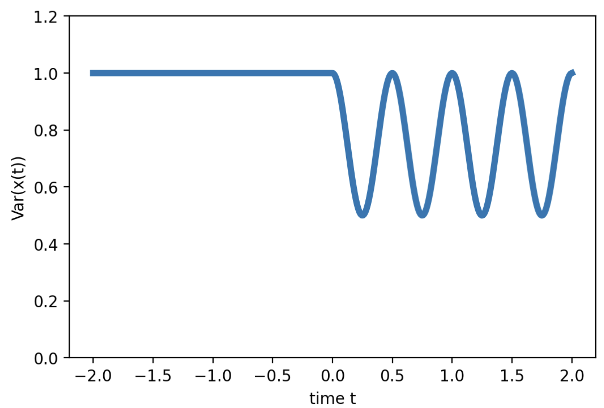
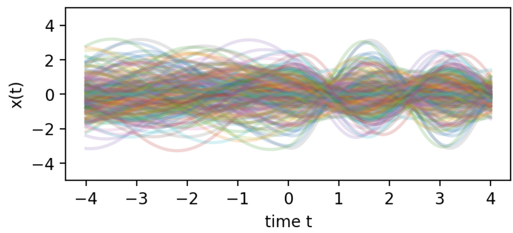

# Being creative in physics - Physics on a swing (example episode)

:::warning
A harmonic oscillator with a time-dependent spring constant: What happens?
:::

---

## Teams

- [A] "The Seven Dwarves"
- [B] "Emmy's Team"
- [C] "Free Fall"

## Possible Questions

### The questions

:::info
1. Let the spring constant increase linearly with time [B]
:::

:::info
2. Consider a time-periodic spring constant. [A]
:::

:::info
3. When does the energy increase? [B]
:::

:::info
4. Consider a jump in the spring constant. [C]
:::

### Ranking the questions

Order of investigation (easiest, most concrete first)

[A] 4, 1, 2, 3
[B] 4, 2, 1, 3
[C] 1, 4, 2, 3

Most interesting long-term listed first

[A] 2,3,1,4
[B] 3,2,1,4
[C] 2,3,4,1

## Research Progress

:::info
1 - Nothing happens when the particle starts at rest at the origin. We need to consider the initial conditions!
[B] Oct 16 18:35
:::

:::info
2 - When there is a jump in the spring constant at t=0, the oscillation frequency changes, since $\omega=\sqrt{D/m}$, where $D$ is the spring constant. The solution for $t>0$ is then $x(t)=x(0) \cos(\omega t) + (p(0)/m \omega) \sin(\omega t)$.
[C] Oct 16 18:39
:::

:::info
3 - We could assume the harmonic oscillator to be initially in thermal equilibrium, with a Gaussian distribution of x and p ! And then start changing the spring constant.
[A] Oct 16 18:42
:::

:::info
4 - Following the suggestion of [3] and the solution given by [2], we have looked at how the variance of x changes with time after a jump in the spring constant. We find ${\rm Var}(x(t))={\rm Var}(x(0)) \cos^2(\omega t) + {\rm Var }(p(0)/(m\omega)) \sin^2(\omega t)$. Here we have used the fact that there is no correlation between x(0) and p(0). We note that in equilibrium ${\rm Var }(p(0)/(m\omega))={\rm Var}(x(0))$, which leads to a time-independent result, since the cos and sin terms add up to one. However, if the $\omega$ at $t>0$ is different from the $\omega$ describing the equilibrium distribution, then there will be some time-dependence!
[B] Oct 16 18:55
:::

:::info
5 - We have plotted the result of [4], i.e. the variance of position vs time, for the case where the spring constant jumps at time 0. The plot is produced for a case where ${\rm Var }(p(0)/(m\omega))=0.5 {\rm Var}(x(0))$.




[C] Oct 16 19:01

Code:
```python
om = 2*np.pi
t = np.linspace(-2,2.,400)
var_x = (t<0)*1.0 + (t>=0)*(np.cos(om*t)**2 + 0.5*np.sin(om*t)**2)
plt.figure(dpi=200)
plt.plot( t, var_x, linewidth=4)
plt.ylim(0,1.2)
plt.xlabel("time t")
plt.ylabel("Var(x(t))")
plt.show()
```
:::

:::info
6 - It is interesting to plot individual trajectories! Here we have plotted 200 trajectories, where the frequency at time t=0 changes by a factor of 2. Before t=0, the trajectories belong to thermal equilibrium, while for t>0 they continue with a changed spring constant. One clearly sees the periodic change of Var(x(t)), as in the result of [4], in this ensemble of trajectories!



[A] Oct 16 19:07

Code:
```python
om_eq = 1.0
om = 2.0
t = np.linspace(-4,4.,400)
plt.figure(dpi=200,figsize=(5,2))
for n in range(200):
    x0=np.random.randn(1)
    p0_m=np.random.randn(1)
    x = ( (t>=0)*(x0*np.cos(om*t) + (p0_m/om)*np.sin(om*t)) + 
          (t<0)*(x0*np.cos(om_eq*t) + (p0_m/om_eq)*np.sin(om_eq*t)) )
    plt.plot( t, x, linewidth=2, alpha=0.2)
plt.ylim(-5,5)
plt.xlabel("time t")
plt.ylabel("x(t)")
plt.show()
```

:::

:::info
7 - Hey everyone, we should not forget about a time-periodic spring constant! We could e.g. take many jumps in a periodic sequence, or we could simple take $D(t)=D_0 + d \sin(\Omega t)$. It might be interesting to find out what happens in dependence on how the modulation frequency $\Omega$ is in relation to the oscillator frequency  $\omega$ !
[B] Oct 16 19:08
:::

(Here would be many more insights)

---

## Summarizing

(There would be a discussion of the various insights/messages available, and each team focusses on a single message and tries to summarize it)

Selected message: Time-periodic variations of the spring constant can lead to amplification


:::info
[A] "Physics on a swing: Amplification"

Abstract: A child on a swing moves its center-of-mass up and down, which changes the frequency of the swing. As we have shown, this can lead to amplification of initial motion.

More details: The swing can be modelled as a harmonic oscillator for small amplitudes. The periodic changes of the frequency can pump energy into the system, but whether they do depends on the initial conditions and also on the relation between the modulation frequency and the resonance frequency. In our numerical simulations, we have found that certain directions in the phase space of initial conditions get amplified over time, while others become de-amplified. This is expressed by the following formula: (here would be a formula and its explanation)

The results are visualized in the following figure (here would be a figure and its explanation)
:::


---

## Outlook: Future suggestions and questions

:::info
What happens if we have an anharmonic oscillator or a pendulum instead of a harmonic oscillator? Does the anharmonic behaviour stop the exponential growth of amplitude?
[B]
:::

:::info
Suppose we have a system of coupled harmonic oscillators, e.g. even an infinitely long chain of such oscillators. Suppose we drive this chain by changing some parameter, like the coupling between subsequent oscillators. What happens?
[C]
:::

:::info
What are the most practical experimental implementations of a harmonic oscillator with time-dependent spring constant?
[A]
:::

